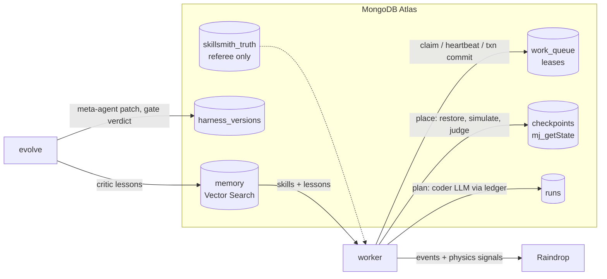

# Skill Smith

**A self-improving harness for a warehouse packing robot. The model never changes. The harness does.**

A Franka Panda arm in a MuJoCo simulation packs real, 3D-scanned snacks ("MongoDB hackathon snack box for Dev
Ittycheria") into a green box. A cheap LLM (`anthropic/claude-haiku-5.5`) writes the packing program. A deterministic
referee grades every item using **hidden physics** (mass, friction, crush limit, wet or shifted contents) that the
agents can't read. Failures become lessons, clean packs become skills, both in **Atlas Vector Search**. Every
failure is sent to **Raindrop** as a physics signal. A meta-agent (`anthropic/claude-sonnet-5.5`) reads those signals
and proposes **one typed patch** to the harness config (the "genome"). A **gate** keeps the patch only if it wins a
paired comparison without breaking guardrails. The whole night shift runs as a **durable queue in Atlas** with exact
physics checkpoints: `kill -9` the worker mid-item, restart, and it resumes from the same physics state (pixel diff 0).

Built at the MongoDB hackathon, San Francisco, 2026-10-11. Problem statements: **Recursive Harnessing** (genome +
gate) and **Long Horizon Engineering** (durable queue, checkpoints, memory that compounds across generations).

## How it works



1. **Plan step:** the coder gets the harness rules, enabled tools, and retrieved lessons and skills, then writes
   `def pack(api):`. The program runs in a restricted sandbox against a recording API. Tool answers (`weigh`,
   `squeeze_test`) come from the hidden truth, bucketed and noisy. The result is an action list.
2. **Place steps (one per item):** rebuild the scene, restore the previous step's checkpoint (`mj_setState`), run
   pick and place, and judge with the referee. One Atlas transaction then commits the run update, the new physics
   checkpoint and the step's completion. It only commits if this worker still holds the lease token.
3. **Verify step:** totals, a Raindrop event with one signal per item (`crushed`, `slipped`, `tipped`,
   `packed_clean`, plus `capability_gap` from the coder), and skills from clean packs.
4. **Evolve:** the critic writes lessons from training failures. The meta-agent proposes one patch from a whitelist.
   The gate evaluates it on train (T) and held-out (H) orders, 2 repeats each, plus an incumbent control rerun. It
   keeps the patch only if T improves with P(better) ≥ 0.8 (bootstrap over orders), H doesn't drop, no failure family
   regresses by more than 1 item, cycle time stays within +20% and cost within 2×.

### The task (why it's hard)
- Each product is the scanned mesh for looks plus a box proxy with the real mass for physics.
- Grip levels are calibrated force-controlled closes: soft ~5 N, medium ~11 N, firm ~22 N, max ~47 N per finger.
- Thin cartons crush above ~7–9 N, even with a soft grip if moved fast. Heavy items slip at low grip. Wet canisters
  need firm. Each order has an 18 s budget: three items at normal speed don't fit, so the coder has to decide which
  items can go fast.
- No-LLM oracle: every item is solvable by some grip × speed; the best one-size-fits-all plan reaches 76%.

### Atlas features used
Atomic claim with lease (`findOneAndUpdate`), heartbeats, multi-document transactions with lease-token checks,
idempotent upserts, a unique-index LLM ledger (no double spend on replay), Vector Search with pre-filters (one index
serves lessons and skills), aggregation pipelines for per-family and per-class failure rates, and a separate truth
database.

### Honest notes
- **Truth separation:** only the referee path opens `skillsmith_truth`. The meta-agent's query tool runs on a
  separate `harness_app` login (`MONGODB_URI_HARNESS`), which is trusted only after a live check that Atlas refuses
  it on the truth database (code 13). Without that, it falls back to a code-level wall that raises the same error.
  The feed says which one is active.
- **Raindrop read-back:** the meta-agent reads its signal counts per harness version back from Raindrop's Query API
  (`events.count` filtered by signal and `harness_version`), and falls back to the same facts in Atlas.
- Masses and material limits are assumptions anchored to package weights and published friction ranges. Held-out
  products never appear in training orders, and lessons and skills are only learned from training orders.

## Run it
```bash
cp .env.example .env.local            # MONGODB_URI, OPENROUTER_API_KEY, VOYAGE_API_KEY, RAINDROP_WRITE_KEY
cd core && ./scripts/fetch_assets.sh && uv sync
uv run skillsmith seed --reset        # products, fixed suites, hidden truth, indexes
uv run skillsmith evolve --generations 8 --workers 8
uv run skillsmith final-exam          # never-seen snacks: v0 vs best
uv run skillsmith demo-kill           # kill -9 mid-order, restart, resume from checkpoint
uv run skillsmith live                # pack judge requests from the web form
uv run skillsmith status
cd ../web && npm install && npm run dev
```

## Credits
- Products: [Google Scanned Objects](https://research.google/blog/scanned-objects-by-google-research-a-dataset-of-3d-scanned-common-household-items/)
  (CC-BY 4.0), MuJoCo models via [kevinzakka/mujoco_scanned_objects](https://github.com/kevinzakka/mujoco_scanned_objects) (MIT).
- Robot: Franka Emika Panda from [MuJoCo Menagerie](https://github.com/google-deepmind/mujoco_menagerie) (Apache-2.0).
- Physics: [MuJoCo](https://mujoco.org). LLMs via [OpenRouter](https://openrouter.ai). Embeddings: [Voyage AI](https://www.voyageai.com).
  Observability: [Raindrop](https://www.raindrop.ai).
